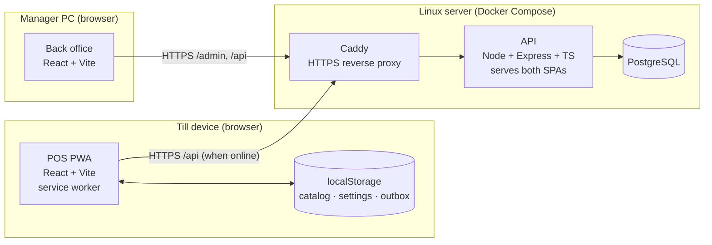

# 03 — Architecture

## 1. Overview



- **One API process** handles `/api/*`, serves the POS build at `/` and the back office build at `/admin`.
- **Caddy** terminates TLS. HTTPS is required, because service workers (offline mode) only run in a secure context.
- **PostgreSQL** is the only datastore. There is no cache or queue server.

## 2. Repository layout

```
pos-system/
├── apps/
│   ├── api/
│   │   ├── prisma/schema.prisma      # data model (see 04)
│   │   └── src/
│   │       ├── index.ts              # express app, static hosting, error handler
│   │       ├── seed.ts               # Setting row, admin user, dev sample data
│   │       ├── auth.ts               # JWT, bcrypt, requireRole(), permission map
│   │       ├── totals.ts             # computeTotals() — shared with POS
│   │       └── routes/               # auth, users, categories, products, inventory,
│   │                                 # customers, sales, reports, settings
│   ├── backoffice/                   # React + Vite + React Router
│   └── pos/                          # React + Vite + vite-plugin-pwa
│       └── src/outbox.ts, catalog.ts # offline storage + sync loop
├── docker-compose.yml                # dev: postgres
├── docker-compose.prod.yml           # prod: caddy + api + postgres
├── Dockerfile                        # multi-stage: build SPAs + API
└── docs/
```
npm workspaces. There's no shared package yet: the POS imports `apps/api/src/totals.ts` directly, so client and server use **the same** money maths.

## 3. Backend design
- **Layers:** route handler → zod validation → Prisma call(s) inside `prisma.$transaction` where several tables change. There is no service/repository layer, because the handlers are short.
- **Auth middleware:** `requireAuth` verifies the JWT, and `requireRole('MANAGER')` checks rank (`CASHIER < MANAGER < ADMIN`).
- **Errors:** a single error handler maps zod errors → 400, Prisma `P2002` (unique) → 409, `P2025` (not found) → 404, and anything else → 500 (logged, generic message to the client).
- **Money:** `Decimal(10,2)` in Postgres (`Decimal(8,2)` for product price/cost/tax rate), returned by Prisma as `Decimal` and sent as strings in JSON. Arithmetic happens in `computeTotals` only (§3.1). Floats never touch money.
- **Time:** stored as UTC `timestamptz`. Reports bucket days in `Setting.timezone` using `AT TIME ZONE`.

### 3.1 `computeTotals` (shared)
```ts
// input: [{ unitPrice: "6.50", qty: 2, discount: "1.00", taxRate: "10.00" }]   (decimal strings)
// internally: toCents("6.50") = 650 by splitting the string (no parseFloat), integer maths, back to "x.yy"
lineGross    = unitPrice * qty
lineNet      = lineGross - discount
lineTax      = Math.round(lineNet * toCents(taxRate) / 10000)  // rate "10.00" → 1000; half-up, per line
lineTotal    = lineNet + lineTax
subtotal     = Σ lineGross
discount     = Σ discount
tax          = Σ lineTax
total        = subtotal - discount + tax
```
Prices are tax-exclusive. Tax is rounded per line, so a receipt's lines always add up to its total.

## 4. Frontend design
- **Back office:** React Router pages, a ~30-line `api()` fetch wrapper that adds the bearer token and redirects to login on 401, and no global state library. Tables are plain HTML with sorting done client-side.
- **POS:** a single-page sell screen with local React state for the cart. It reads **only from the local cache** for products and settings, so the online and offline code paths are the same.

## 5. Offline design

| Concern | Solution |
|---|---|
| App loads without network | `vite-plugin-pwa` precaches the built JS/CSS/HTML (app shell). |
| Products and prices offline | `catalog.ts` stores products, categories and customers in localStorage. It refreshes on login and every 5 min with `GET /products?updatedSince=<last sync>` (deltas only). |
| Settings for receipts | `GET /settings` is cached in localStorage. |
| Recording a sale | The sale is written to the **outbox** (localStorage) *before* the receipt prints, so it's on the device first. |
| Uploading | `outbox.ts` loop: on `online` event + every 30 s, POST each entry oldest-first. It's removed only on 2xx. A 4xx (other than 401) marks it `needsAttention`, and 401 pauses sync until the next login. |
| Duplicates | The client creates `Sale.id` as a UUID (`crypto.randomUUID()`). The server treats a repeated id as already done and returns the stored sale. |
| Receipt numbers without the server | `<deviceCode>-<6-digit local counter>`, e.g. `T1-000123`, with the counter in localStorage. Unique per till. |
| Stock conflicts | Stock may go negative, and the server never rejects a sale for stock. Negative stock surfaces in the low-stock report. |
| Stale prices | A sale stores the price the till actually charged (`unitPrice` per line). The server accepts it and recomputes totals only to check the arithmetic. |
| Expired login offline | The cashier keeps selling, and sync resumes after the next PIN login. Logging *in* needs the server. |
| Who synced | `Sale.syncedById` records the uploading user, which may differ from `cashierId` if another cashier logs in first. |

```mermaid
sequenceDiagram
  participant C as Cashier
  participant P as POS (browser)
  participant O as Outbox (localStorage)
  participant A as API
  participant D as Postgres
  C->>P: Pay (network down)
  P->>O: save sale {id: uuid, receiptNo: T1-000124}
  P->>C: print receipt
  Note over P: header: Offline · 1 pending
  P-->>A: (network back) POST /api/sales
  A->>A: validate + computeTotals check
  A->>D: BEGIN; insert Sale (ON CONFLICT id DO NOTHING)
  alt new sale
    A->>D: insert items, payments, SALE movements; update stockQty; COMMIT
    A-->>P: 201 Created
  else id already exists
    A-->>P: 200 OK (existing sale)
  end
  P->>O: remove entry
```

Ceiling: localStorage is ~5 MB per origin. That's fine for about 3,000 products plus a few hundred queued sales. Move the catalog and outbox to IndexedDB if the catalog grows beyond that.

## 6. Key decisions

| # | Decision | Why | Revisit when |
|---|---|---|---|
| D1 | Payments are recorded, not processed | Standalone terminal already exists, and processor integration is costly and hardware-bound | Shop wants integrated card terminals |
| D2 | Single store, `Product.stockQty` column + movement ledger | Simplest correct model for one location, and the ledger gives an audit trail | A second location opens (add `Location` + per-location stock) |
| D3 | Client-generated UUID sale ids | Makes offline resend idempotent with no extra protocol | — |
| D4 | Allow negative stock | Offline sales can't be refused, and the stock count fixes it | — |
| D5 | Roles as an enum + code permission map | Three fixed roles, and a role table adds UI and complexity for nothing | Shop needs custom roles |
| D6 | API serves the SPAs | One container to deploy, and same-origin means no CORS in production | Separate CDN hosting is wanted |
| D7 | localStorage over IndexedDB | Synchronous, tiny API, enough for target catalog size | Catalog > ~3k products |
| D8 | Tax-exclusive prices, per-line rounding | Lines always add up to the total, and the maths is easy to test | Tax-inclusive pricing is required |
