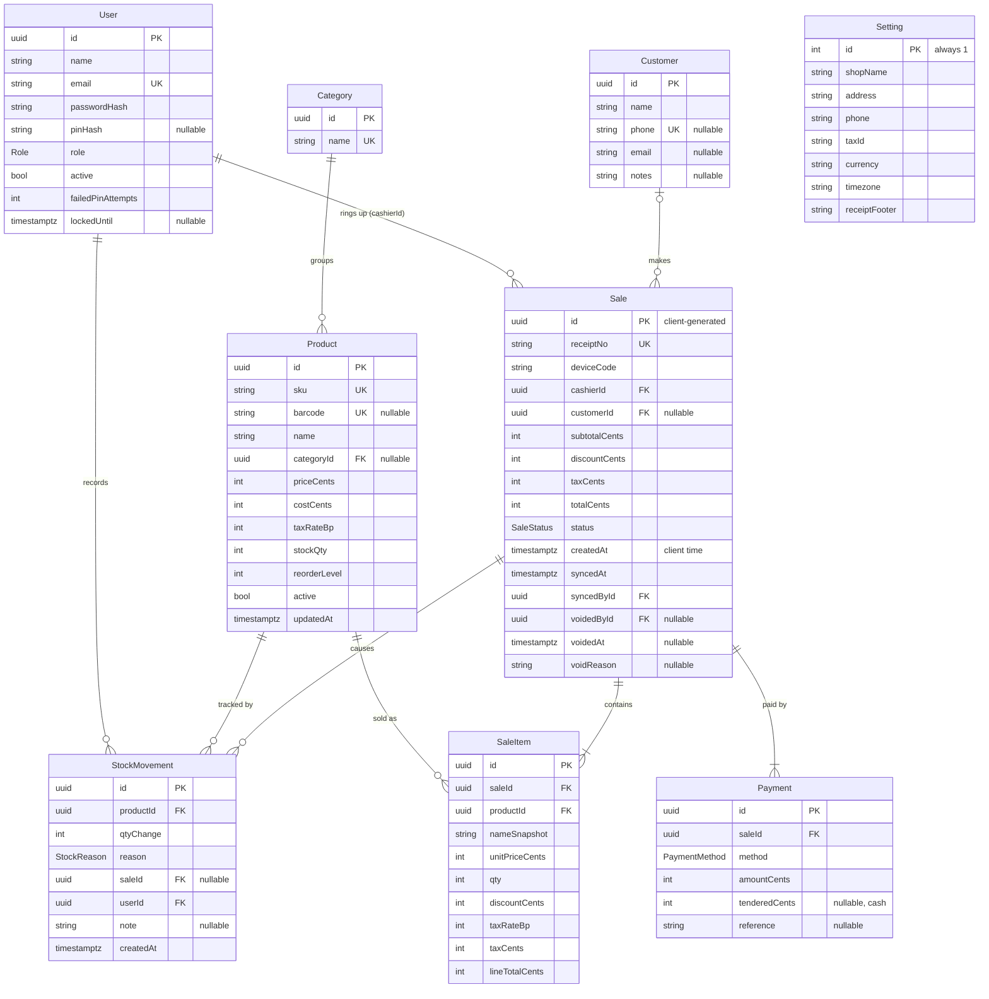

# 04 — Database Schema

PostgreSQL 16, managed with Prisma migrations. Table names are the Prisma model names.

## 1. ER diagram



## 2. Enums
| Enum | Values |
|---|---|
| `Role` | `ADMIN`, `MANAGER`, `CASHIER` |
| `StockReason` | `SALE` (−), `RECEIVE` (+), `ADJUST` (±), `RETURN` (+) |
| `SaleStatus` | `COMPLETED`, `VOIDED` |
| `PaymentMethod` | `CASH`, `CARD`, `OTHER` |

## 3. Tables

### User
| Column | Type | Constraints / notes |
|---|---|---|
| id | uuid | PK, default `gen_random_uuid()` |
| name | text | required |
| email | text | unique, stored lowercase |
| passwordHash | text | bcrypt, cost 12 |
| pinHash | text? | bcrypt of 4–6 digit PIN, and null means no POS login |
| role | Role | default `CASHIER` |
| active | bool | default true. Users are never hard-deleted |
| failedPinAttempts | int | default 0, reset on success |
| lockedUntil | timestamptz? | set for 15 min after 5 failed PINs |
| createdAt / updatedAt | timestamptz | |

### Category
| Column | Type | Notes |
|---|---|---|
| id | uuid | PK |
| name | text | unique |
| createdAt / updatedAt | timestamptz | |

### Product
| Column | Type | Notes |
|---|---|---|
| id | uuid | PK |
| sku | text | unique |
| barcode | text? | unique when present |
| name | text | |
| categoryId | uuid? | FK → Category, `ON DELETE RESTRICT` |
| priceCents | int | ≥ 0, tax-exclusive |
| costCents | int | ≥ 0 |
| taxRateBp | int | basis points, e.g. 1000 = 10 %. Range 0–10000 |
| stockQty | int | **can be negative**. Changed only alongside a StockMovement |
| reorderLevel | int | default 0 |
| active | bool | default true |
| createdAt / updatedAt | timestamptz | `updatedAt` indexed (POS delta sync) |

### StockMovement
| Column | Type | Notes |
|---|---|---|
| id | uuid | PK |
| productId | uuid | FK → Product |
| qtyChange | int | non-zero, signed |
| reason | StockReason | |
| saleId | uuid? | FK → Sale for `SALE`/`RETURN` |
| userId | uuid | FK → User who caused it |
| note | text? | required by API for `ADJUST` |
| createdAt | timestamptz | index `(productId, createdAt)` |

### Customer
| Column | Type | Notes |
|---|---|---|
| id | uuid | PK |
| name | text | |
| phone | text? | unique when present, normalised to digits and a leading `+` |
| email | text? | |
| notes | text? | |
| createdAt / updatedAt | timestamptz | |

### Sale
| Column | Type | Notes |
|---|---|---|
| id | uuid | PK, **generated by the POS** |
| receiptNo | text | unique, `T1-000123` |
| deviceCode | text | till that made the sale |
| cashierId | uuid | FK → User |
| customerId | uuid? | FK → Customer, `ON DELETE RESTRICT` |
| subtotalCents, discountCents, taxCents, totalCents | int | as computed by `computeTotals` |
| status | SaleStatus | default `COMPLETED` |
| createdAt | timestamptz | time on the till when paid. Index for reports |
| syncedAt | timestamptz | default `now()` (server receipt time) |
| syncedById | uuid | FK → User who uploaded |
| voidedById, voidedAt, voidReason | | set together on void |

### SaleItem
| Column | Type | Notes |
|---|---|---|
| id | uuid | PK |
| saleId | uuid | FK → Sale, `ON DELETE CASCADE` |
| productId | uuid | FK → Product |
| nameSnapshot | text | product name at time of sale |
| unitPriceCents | int | price charged |
| qty | int | > 0 |
| discountCents | int | 0 ≤ discount ≤ unitPrice × qty |
| taxRateBp | int | rate at time of sale |
| taxCents, lineTotalCents | int | |

### Payment
| Column | Type | Notes |
|---|---|---|
| id | uuid | PK |
| saleId | uuid | FK → Sale, `ON DELETE CASCADE` |
| method | PaymentMethod | |
| amountCents | int | > 0, amount applied to the sale |
| tenderedCents | int? | cash only, ≥ amount. Change = tendered − amount |
| reference | text? | card last4/approval code, transfer ref |

### Setting
A single row with `id = 1`: `shopName`, `address`, `phone`, `taxId`, `currency` (ISO 4217, default `USD`), `timezone` (IANA, e.g. `Asia/Phnom_Penh`), `receiptFooter`, `updatedAt`.

## 4. Invariants (enforced in the API, inside one transaction)
1. `Product.stockQty = Σ StockMovement.qtyChange` for that product. Every stock change writes both.
2. `Sale.totalCents = subtotal − discount + tax`, and lines are computed by `computeTotals` (see [03 §3.1](03-architecture.md#31-computetotals-shared)).
3. `Σ Payment.amountCents = Sale.totalCents`.
4. A voided sale has exactly one `RETURN` movement per item, so its stock is restored once.
5. Products, users and customers with sales are never hard-deleted.

DB-level `CHECK` constraints (added via a raw SQL migration): `priceCents >= 0`, `costCents >= 0`, `qty > 0`, `amountCents > 0`, `taxRateBp BETWEEN 0 AND 10000`.

## 5. Indexes
- Unique: `User.email`, `Category.name`, `Product.sku`, `Product.barcode`, `Customer.phone`, `Sale.receiptNo`.
- `Product(updatedAt)`, `Product(name)` (search, via `ILIKE` / `pg_trgm` later if slow).
- `Sale(createdAt)`, `Sale(cashierId, createdAt)`, `Sale(customerId)`.
- `SaleItem(saleId)`, `SaleItem(productId)`, `Payment(saleId)`, `StockMovement(productId, createdAt)`.

## 6. Prisma schema (draft)

```prisma
generator client {
  provider = "prisma-client-js"
}

datasource db {
  provider = "postgresql"
  url      = env("DATABASE_URL")
}

enum Role {
  ADMIN
  MANAGER
  CASHIER
}

enum StockReason {
  SALE
  RECEIVE
  ADJUST
  RETURN
}

enum SaleStatus {
  COMPLETED
  VOIDED
}

enum PaymentMethod {
  CASH
  CARD
  OTHER
}

model User {
  id                String    @id @default(uuid()) @db.Uuid
  name              String
  email             String    @unique
  passwordHash      String
  pinHash           String?
  role              Role      @default(CASHIER)
  active            Boolean   @default(true)
  failedPinAttempts Int       @default(0)
  lockedUntil       DateTime?
  createdAt         DateTime  @default(now())
  updatedAt         DateTime  @updatedAt

  sales          Sale[]          @relation("cashier")
  syncedSales    Sale[]          @relation("syncedBy")
  voidedSales    Sale[]          @relation("voidedBy")
  stockMovements StockMovement[]
}

model Category {
  id        String    @id @default(uuid()) @db.Uuid
  name      String    @unique
  products  Product[]
  createdAt DateTime  @default(now())
  updatedAt DateTime  @updatedAt
}

model Product {
  id           String    @id @default(uuid()) @db.Uuid
  sku          String    @unique
  barcode      String?   @unique
  name         String
  categoryId   String?   @db.Uuid
  category     Category? @relation(fields: [categoryId], references: [id], onDelete: Restrict)
  priceCents   Int
  costCents    Int       @default(0)
  taxRateBp    Int       @default(0)
  stockQty     Int       @default(0)
  reorderLevel Int       @default(0)
  active       Boolean   @default(true)
  createdAt    DateTime  @default(now())
  updatedAt    DateTime  @updatedAt

  saleItems      SaleItem[]
  stockMovements StockMovement[]

  @@index([updatedAt])
  @@index([name])
}

model StockMovement {
  id        String      @id @default(uuid()) @db.Uuid
  productId String      @db.Uuid
  product   Product     @relation(fields: [productId], references: [id])
  qtyChange Int
  reason    StockReason
  saleId    String?     @db.Uuid
  sale      Sale?       @relation(fields: [saleId], references: [id])
  userId    String      @db.Uuid
  user      User        @relation(fields: [userId], references: [id])
  note      String?
  createdAt DateTime    @default(now())

  @@index([productId, createdAt])
}

model Customer {
  id        String   @id @default(uuid()) @db.Uuid
  name      String
  phone     String?  @unique
  email     String?
  notes     String?
  sales     Sale[]
  createdAt DateTime @default(now())
  updatedAt DateTime @updatedAt
}

model Sale {
  id            String     @id @db.Uuid // generated by the POS
  receiptNo     String     @unique
  deviceCode    String
  cashierId     String     @db.Uuid
  cashier       User       @relation("cashier", fields: [cashierId], references: [id])
  customerId    String?    @db.Uuid
  customer      Customer?  @relation(fields: [customerId], references: [id], onDelete: Restrict)
  subtotalCents Int
  discountCents Int
  taxCents      Int
  totalCents    Int
  status        SaleStatus @default(COMPLETED)
  createdAt     DateTime
  syncedAt      DateTime   @default(now())
  syncedById    String     @db.Uuid
  syncedBy      User       @relation("syncedBy", fields: [syncedById], references: [id])
  voidedById    String?    @db.Uuid
  voidedBy      User?      @relation("voidedBy", fields: [voidedById], references: [id])
  voidedAt      DateTime?
  voidReason    String?

  items          SaleItem[]
  payments       Payment[]
  stockMovements StockMovement[]

  @@index([createdAt])
  @@index([cashierId, createdAt])
  @@index([customerId])
}

model SaleItem {
  id             String  @id @default(uuid()) @db.Uuid
  saleId         String  @db.Uuid
  sale           Sale    @relation(fields: [saleId], references: [id], onDelete: Cascade)
  productId      String  @db.Uuid
  product        Product @relation(fields: [productId], references: [id])
  nameSnapshot   String
  unitPriceCents Int
  qty            Int
  discountCents  Int     @default(0)
  taxRateBp      Int
  taxCents       Int
  lineTotalCents Int

  @@index([saleId])
  @@index([productId])
}

model Payment {
  id            String        @id @default(uuid()) @db.Uuid
  saleId        String        @db.Uuid
  sale          Sale          @relation(fields: [saleId], references: [id], onDelete: Cascade)
  method        PaymentMethod
  amountCents   Int
  tenderedCents Int?
  reference     String?

  @@index([saleId])
}

model Setting {
  id            Int      @id @default(1)
  shopName      String   @default("My Shop")
  address       String   @default("")
  phone         String   @default("")
  taxId         String   @default("")
  currency      String   @default("USD")
  timezone      String   @default("UTC")
  receiptFooter String   @default("Thank you!")
  updatedAt     DateTime @updatedAt
}
```

## 7. Seed data (`apps/api/src/seed.ts`, compiled to `dist/seed.js` so it can run in production)
- The `Setting` row with id 1.
- An admin user from the `SEED_ADMIN_EMAIL` / `SEED_ADMIN_PASSWORD` env vars.
- Dev only: 2 categories, 10 products with barcodes, a manager and a cashier (PIN `1234`), and 3 customers.
